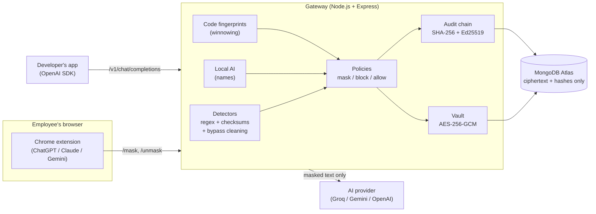

# 🛡️ Safe AI Data Gateway

**Use ChatGPT, Claude and Gemini at work without leaking customer data, keys or source code.**

**Live demo:** https://safe-ai-gateway.onrender.com (free server: the first visit after a quiet period takes about a minute to wake up. Use fake data only.)

Employees paste customer details, API keys and private code into AI chatbots every day.
This gateway and its browser extension replace the sensitive parts with tags like `[[EMAIL_1]]`
*before* the text leaves the company. The AI then answers using those tags, and the real values
are put back for the employee on their own screen.

```
You type:        Refund Rahul Verma, rahul@gmail.com, PAN ABCPE1234F
ChatGPT gets:    Refund [[PERSON_1]], [[EMAIL_1]], PAN [[PAN_1]]
ChatGPT replies: Dear [[PERSON_1]], your refund for PAN [[PAN_1]] is processed…
You see:         Dear Rahul Verma, your refund for PAN ABCPE1234F is processed…
```

Free, self-hosted, and built for India: Aadhaar, PAN and GSTIN are validated with their real checksums.

---

## What makes it different

| | |
|---|---|
| 🇮🇳 **India-first detection** | Aadhaar (Verhoeff checksum), PAN (holder-type check), GSTIN (mod-36 checksum), UPI IDs, IFSC, bank accounts, voter ID, passport, driving licence, Indian PIN-code addresses |
| 😈 **Can't be bypassed with tricks** | Catches data written in Hindi/Bengali/Tamil digits (`२३४५ ६७८९ ०१२४`), with invisible characters, Cyrillic look-alike letters, full-width text or spaced-out digits, and logs each attempt |
| 🔒 **Protects source code** | Registered repos are fingerprinted with *winnowing* (the algorithm behind the MOSS plagiarism detector). Pasted code is blocked even with every variable renamed and the formatting changed. No code is ever stored, only keyed hashes |
| 🤖 **Local AI for names** | A BERT named-entity model runs *inside* the gateway (offline, ~10 ms) to find people's names. Names never go to another AI just to be detected |
| 🧾 **Tamper-proof evidence (DPDP Act)** | Every event is SHA-256 hash-chained with an Ed25519-signed head. Editing or deleting any audit entry is detected. Signed DPDP evidence reports |
| 🔐 **Encrypted vault** | Real values are stored with AES-256-GCM, one HKDF-derived key per session, sealed to their tag, and deleted automatically after 24 h |

## Architecture



**Neither the database nor the AI provider ever sees a real value.** Atlas stores only ciphertext,
keyed hashes and counts. The master key lives only in the gateway's environment.

## Three ways to use it

1. **Browser extension**: protects people using chatgpt.com, claude.ai and gemini.google.com directly. It's connected to the live gateway: install it and use it, with nothing to set up. [Install guide](extension/README.md).
2. **API proxy**: OpenAI-compatible `POST /v1/chat/completions`. Existing code changes **one line**, the base URL.
3. **Playground + dashboard**: try it in any browser, and see what was stopped, by whom and where.

## Quick start (Windows `cmd`, all free)

You need Node.js 24, a free [MongoDB Atlas](https://www.mongodb.com/cloud/atlas) M0 cluster and,
optionally, a free [Groq](https://console.groq.com) API key.

```
cd gateway
npm install
copy .env.example .env
npm run gen-key
```

Put the generated key in `.env` as `MASTER_KEY=`, then add your `MONGODB_URI` (and `AI_API_KEY`).

| Command | What it does |
|---|---|
| `npm run dev` | Start the gateway on http://127.0.0.1:7000 (reloads on save) |
| `npm test` | Run the 250 automated tests (some against your Atlas test databases) |
| `npm run check-db` | Check the Atlas connection without printing the password |
| `npm run check-ai` | Check the AI key and list the models it can use |
| `npm run register-code -- ../demo/acme-payments` | Protect a code folder (only fingerprints are stored) |
| `npm run tamper-demo` | Watch the audit chain catch an attacker (uses a throwaway database) |
| `npm run vault-demo` | See exactly what Atlas stores for a masked value |
| `npm run download-model` | Download the local AI name model ahead of time (Render does this while building) |

Then open:
- **http://127.0.0.1:7000**: playground (mask → real AI → restore)
- **http://127.0.0.1:7000/dashboard.html**: dashboard, policies, audit verification
- **http://127.0.0.1:7000/chat-demo.html**: demo chat for the extension

**Browser extension:** `chrome://extensions` → *Developer mode* → *Load unpacked* → select the `extension` folder. It always talks to the live gateway. To use a gateway on your laptop instead, change `GATEWAY_URL` in `extension/background.js` and `host_permissions` in `extension/manifest.json`.

## Deploy online (free)

`render.yaml` describes the whole service for [Render](https://render.com)'s free plan:
512 MB RAM (the gateway uses about 290 MB with the AI model), free HTTPS, auto-deploy on every push.

1. Push this repo to GitHub.
2. Render → **New → Blueprint** → pick the repo. Paste `MONGODB_URI`, `MASTER_KEY` (the same one as on your laptop) and `AI_API_KEY` when asked. Render generates `ADMIN_KEY` itself.
3. MongoDB Atlas → **Network Access** → allow `0.0.0.0/0` (Render's free plan has no fixed IP).
4. Open `https://<your-service>.onrender.com`. A free service sleeps after 15 minutes without visitors, so the first visit takes about a minute.

Setting `HOST=0.0.0.0` switches on **public mode** (see `gateway/src/security.js`).

## Security design

| Concern | How it's handled |
|---|---|
| Database stolen | Values are AES-256-GCM ciphertext; keys are derived per session (HKDF) from a master key that is never stored in the database |
| Ciphertext swapped between rows | GCM associated data binds each value to its session and tag, so swapping fails decryption |
| Same value, consistent tags | HMAC-SHA256 fingerprint (keyed, irreversible) with a unique index |
| Simultaneous requests | Atomic `$inc` counters + unique indexes, tested with 10–20 parallel writers |
| Audit log edited | Hash chain + Ed25519-signed head: edits, deletions, truncation and full rewrites are all detected |
| AI drops or alters a tag | The proxy instructs the model to keep tags; restore accepts `[EMAIL_1]`, `[[ EMAIL_1 ]]`… |
| Gateway down | Extension refuses to send by default (fail-closed) |
| Unsure the text was replaced | Extension re-reads the editor and refuses to send unless it matches the masked text |
| Strangers online | Public mode: HTTPS only, security headers (CSP), per-visitor rate limits, a daily cap on AI requests, and an admin key to change policies |
| Data kept forever | TTL indexes delete vault data after 24 h and audit logs after 90 days |

## Project structure

```
gateway/
  src/
    detectors/     email, phone, PAN, Aadhaar, India IDs, secrets, entropy, addresses, normalize (bypass)
    ai/            local name finder (BERT-NER), LLM client (Groq/Gemini/Ollama)
    code/          winnowing fingerprints + code guard
    crypto/        HKDF keys, AES-GCM + HMAC, Ed25519 signing
    audit/         hash chain, DPDP report
    models/        MongoDB collections
    routes/        HTTP endpoints
    masker.js      detect → policy → vault → replace → audit
    vault.js       encrypted storage of real values
  public/          playground, dashboard, demo chat
  test/            250 tests
extension/         Chrome extension (Manifest V3)
demo/              fake "ACME Payments" repo + demo script
PLAN.md            full design and build log
```

## Free stack

Node.js 24 · Express 5 · helmet · express-rate-limit · MongoDB Atlas M0 · Mongoose · `node:crypto` · libphonenumber-js ·
transformers.js (BERT-NER, local) · Groq free tier · Render free plan · Chrome Manifest V3 · plain HTML/CSS/SVG (no chart library).
Total cost: **₹0**.

## Known limitations

- Names are found in Latin script only; a name written in Devanagari isn't detected yet.
- The extension checks what's typed or pasted into the chat box; file uploads aren't checked yet.
- Very common boilerplate code in a registered repo could match identical boilerplate elsewhere.
- Rolling the audit log back to an older signed head needs an external anchor to detect (e.g. publishing the daily head hash).
- Streaming responses are not supported by the API proxy yet.

## Comparable products

Commercial AI-DLP tools (Microsoft Purview, Nightfall, Protecto, NexusNest…) cover parts of this.
This project focuses on what was not visible in their public material: bypass-resistant Indian
identifier detection, keyed source-code fingerprinting, and tamper-evident DPDP evidence, free and self-hosted.

---
*Technical evidence to support DPDP Act, 2023 compliance. Not legal advice.*
